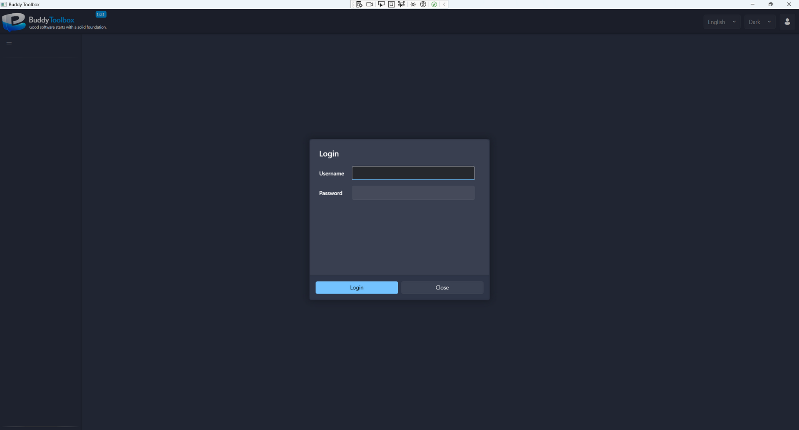
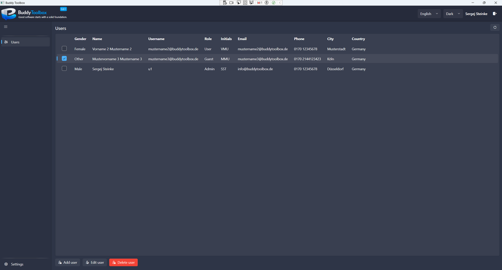
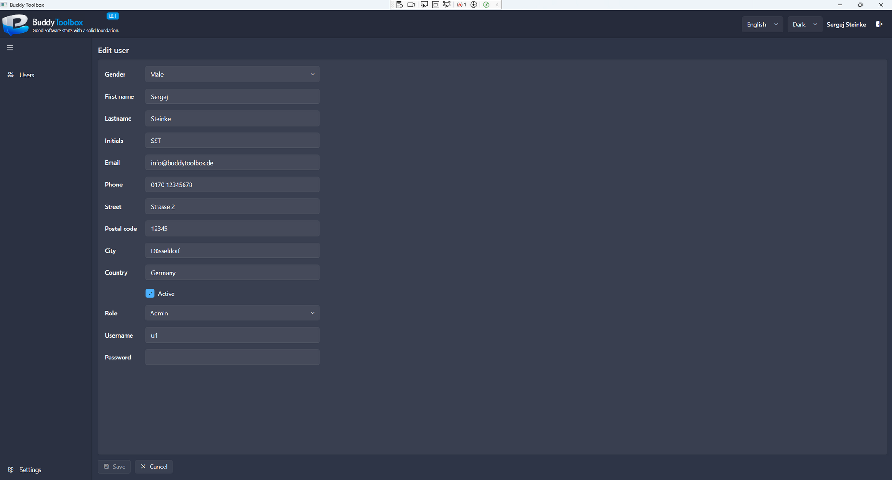
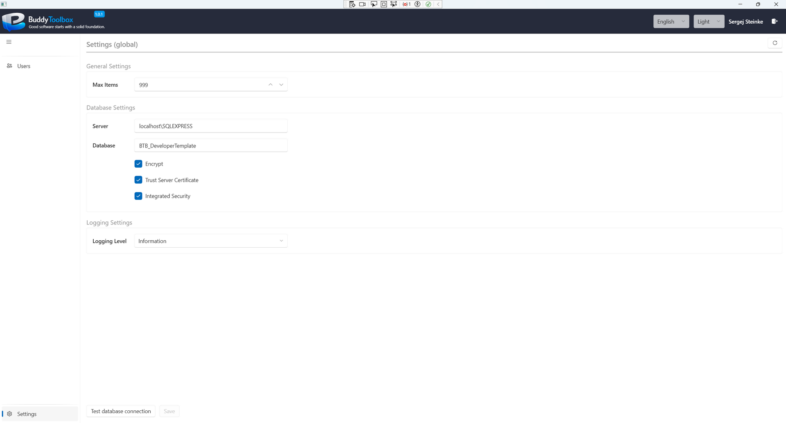

# BuddyToolBox - .NET Developer Template
A modern .NET WPF application template built on a Feature-Based MVVM architecture for scalable and maintainable desktop applications.

## Preview

<table>
<tr>
<td align="center">

 
<b>Login</b>
</td>
<td align="center">

 
<b>Users</b>
</td>
</tr>
<tr>
<td align="center">

 
<b>Edit User</b>
</td>
<td align="center">

 
<b>Settings (Light Theme)</b>
</td>
</tr>
</table>

## Features
- Feature-Based MVVM architecture
- Dependency Injection
- Entity Framework Core
- Microsoft SQL Server
- Application Localization
- Application Theming
- Structured Logging
- Configuration Management
- User Management
- User Authentication
- WPF UI Integration
- Clean, Modular and Maintainable Design
- Reusable Components

## Technology Stack
- C#
- .NET
- Dependency Injection
- WPF
- WPF UI
- CommunityToolkit.Mvvm
- Entity Framework Core
- Microsoft SQL Server

## Architecture
The application follows a Feature-Based MVVM architecture, organizing functionality by feature instead of technical layers.

Shared infrastructure and reusable components are separated from feature-specific implementations, resulting in a modular, scalable, and maintainable codebase.

Each feature can encapsulate its own:
- Views
- ViewModels
- Models
- Services

## Requirements
- .NET SDK 8.0 or later
- Visual Studio 2022 or later
- Microsoft SQL Server (if required by the application)

## Documentation

The project documentation provides detailed information about the architecture, authentication system, development guidelines, and build process.

- [Documentation](docs/DOCUMENTATION.md)
- [Build Instructions](docs/BUILD.md)
- [Changelog](CHANGELOG.md)

## Project Goals

The project provides a production-ready foundation for building modern, scalable, and maintainable WPF applications.

The template focuses on:

- Scalability
- Maintainability
- Reusability
- Developer Productivity
- Clean Code Principles

## License

This project is licensed under the MIT License.

See the [License](LICENSE.txt) file for details.

## Contact
**Sergej Steinke**

Email: info@steinkeweb.de
 
LinkedIn: https://www.linkedin.com/in/sergej-steinke
